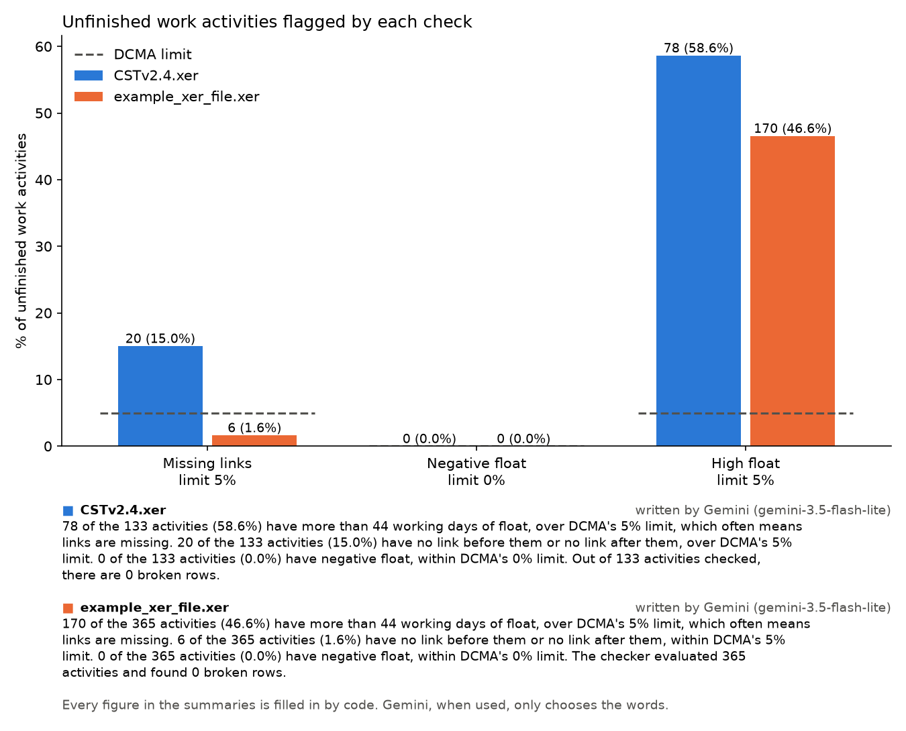

# XER checker

Checks Primavera P6 schedule files (`.xer`): flags broken rows, runs three DCMA checks
(missing links, negative float, high float), draws one chart, and writes a short summary of
each file under it. Gemini can word the summary, but every figure in it comes from code.



<sub>Each bar is the share of a file's unfinished work activities caught by a check; the dashed
line is the DCMA limit. Both files <b>pass</b> negative float. <code>example_xer_file.xer</code> also
<b>passes</b> missing links (1.6%). Over the limit: missing links in <code>CSTv2.4.xer</code> (15.0%), and
high float in both files (58.6% and 46.6%). Under the bars: each file's summary, and who wrote it
(see <a href="#the-ai-summary">The AI summary</a>).</sub>

## Run it

Install what it needs: matplotlib for the chart, plus google-genai and python-dotenv for the
optional AI summary:

```
pip install -r requirements.txt
```

**Check both files in `data/`** and save `chart.png`:

```
python checker.py
```

**Check one file.** Put its path after the script name. This prints the results and leaves
`chart.png` unchanged:

```
python checker.py data/CSTv2.4.xer
```

**See the broken-row check working.** The two real files have no broken rows, so
`broken_test.xer` is a short excerpt of `CSTv2.4.xer`, damaged on purpose:

```
python checker.py broken_test.xer
```

```
broken_test.xer: 4 activities checked
  Broken rows: 7
    line 12: TASK total float 'TBD' is not a number
    line 13: TASK row has 15 values, expected 61
    line 14: line doesn't start with %T, %F, %R or %E: '& Surrounding Area - P1SA NB'
    line 21: TASKPRED link points to an activity that's missing or on a broken row
    ...
    line 26: no %E end marker, so the file may be cut off
  Rows read with blanks at the end: 1
    line 17: TASK row ends early; read as blank: crt_path_num
```

It catches a float typed as text, a row cut short by a line break typed into a task name (and
the stray line that break left behind), links to activities that are missing or on broken rows,
and the missing end marker.

**A row that only ends early is read, not thrown away.** Line 17 is the original row with its
last, empty value dropped. Real exports do this: MPXJ's public test file
`TwentyFourHourCalendar.xer` (P6 8.2) stops before optional columns like `location_id`, and
editors that strip trailing tabs cause the same. Such a row is read with the missing values blank
and listed as a note, but only when none of them is a column the checks need and every value it
has still fits its column (dates look like dates, IDs are numbers, `TK_`/`TT_` codes are in
place). A value missing in the middle shifts the rest out of place, so that row stays broken.
This rule was checked against 10,583 full rows in 8 real exports from 5 sources (P6 8.2 to 24.12).

**A file that can't be checked says why.** There's no crash and no misleading "pass": the
checker names the problem in plain words, goes on to the next file, and exits with code 1.

| File | What the checker says |
|---|---|
| Missing | `can't open the file (no such file or directory)` |
| Empty | `the file is empty` |
| A P6 XML export | `it's an XML file, not an XER export: export the schedule from P6 as XER` |
| Not a P6 export, like a PDF | `it isn't a P6 XER export: line 1 should start with ERMHDR, not '%PDF-1.7'` |
| No activities | `it has no TASK table, so there are no activities to check` |
| A column the checks need is missing | `its TASK table has no status_code column, which the checks need` |

When nothing can be read, the message also names the first broken row, which usually explains
the rest. A file whose activities are all finished, milestones, level of effort or WBS summaries
says "Nothing to check" and shows n/a, not pass. A UTF-8 byte-order mark, or a file re-saved as
UTF-16, is read normally.

**Let Gemini word the summaries (optional).** Without a key, code writes them. Copy the example
settings file, then replace `<YOUR_API_KEY>` in `.env` with your key from
[Google AI Studio](https://aistudio.google.com/apikey):

```
cp .env.example .env
```

`.env` is gitignored, so the key stays on your machine. All the AI settings live there, none in
the code:

| Setting | What it does | In `.env.example` |
|---|---|---|
| `GEMINI_API_KEY` | Turns the AI on; empty turns it off | `<YOUR_API_KEY>` |
| `GEMINI_MODEL` | The model that writes the summaries; required with a key | `gemini-3.5-flash-lite` |
| `GEMINI_THINKING_LEVEL` | How much the model thinks first: `minimal`, `low`, `medium` or `high`; empty for the model's own default | `minimal` |

Rewording numbers that code already computed doesn't need a big model. On the same request,
`gemini-3.5-flash-lite` with minimal thinking answered in 1.8 seconds, where `gemini-3.8-flash`
took 113. A missing or invalid setting never stops the checker: code writes the summary, and the
output names the setting to fix. A variable set in the terminal wins over `.env`, so
`GEMINI_API_KEY= python checker.py` turns the AI off for one run.

**Run the tests.** They need no key or internet, because Gemini's replies are faked:

```
pip install pytest
pytest
```

## Results

| File | Activities checked | Broken rows | Missing links | Negative float | High float |
|---|---|---|---|---|---|
| `CSTv2.4.xer` | 133 | 0 | 20 (15.0%) | 0 | 78 (58.6%) |
| `example_xer_file.xer` | 365 | 0 | 6 (1.6%) | 0 | 170 (46.6%) |

What the results mean:

| | `CSTv2.4.xer` (template, not started) | `example_xer_file.xer` (demo, partly finished) |
|---|---|---|
| Broken rows | None. | None. One calendar is written across 100 lines inside quotes, and it's read correctly. |
| Missing links | All 20 are placeholder rows that come with the MassDOT template, so no real work activity is missing a link. | 6 activities have nothing after them. That's under the 5% limit. |
| Negative float | None. The lowest float is 0 days, on the critical path. | None. Every unfinished activity has at least 6 days of float, and the project is forecast to finish on 6 May 2027, before its 16 May deadline. |
| High float | 20 of the 78 are the same placeholder rows. | 170 activities have more than 44 days of float. |

DCMA treats a number over its limit as a flag: a reason to look closer, not a failed schedule.

## The checks

A few words first:

- **Activity:** one piece of work in the schedule, like "Pour foundation".
- **Link:** a relationship that ties one activity to another, like "B starts after A finishes".
- **Float:** how many working days an activity can slip without delaying the project.
- **Limit:** the most activities a check may catch, out of every 100.

As DCMA says, only unfinished work activities are checked. Finished activities, level-of-effort
activities, WBS summaries and milestones are left out.

| Check | What it looks for | Why it matters | Limit |
|---|---|---|---|
| Missing links | Activities with no link before them or no link after them | A loose activity can slip without moving the finish date, so the schedule can't be trusted | 5 in 100 |
| Negative float | Float below 0 days | The activity is already late for a deadline | 0 (none allowed) |
| High float | Float above 44 working days (about 2 months) | So much spare time can mean a link is missing | 5 in 100 |

Float is converted from hours to days with each activity's own calendar, because P6 stores it
in hours and a working day can be 8 hours or 24.

The checks, limits and exclusions come from the DCMA 14-Point Assessment, section 4 of DCMA's
EVMS Program Analysis Pamphlet (DCMA-EA PAM 200.1, October 2012), the last published version
of the checklist ([copy hosted by Mosaic Projects](https://mosaicprojects.com.au/PDF-Gen/DCMA-PAM-200-1.pdf)).
[Mosaic Projects' white paper](https://www.mosaicprojects.com.au/WhitePapers/WP1088_DCMA-14-Point.pdf)
explains them in plain terms.

What the pamphlet says, and how this checker uses it:

| Rule | From PAM 200.1 | In this checker |
|---|---|---|
| What to check (4.0) | "should exclude Completed tasks, LOE tasks, Subprojects ... and Milestones" | Skips finished, level-of-effort, WBS summary and milestone activities |
| Logic (4.1) | "missing a predecessor and/or a successor ... should not exceed 5%" | Missing links, limit 5% |
| High float (4.6) | "total float greater than 44 working days" ... "If the percentage ... exceeds 5%" | High float, over 44 days, limit 5% |
| Negative float (4.7) | "total float less than 0 working days" ... "there should not be any negative float" | Negative float, limit 0 |
| Over a limit (4.0) | "not in and of itself synonymous with failure" | Reported as FLAG, not FAIL |

A row is broken when it has the wrong number of values, it has no table above it (or its `%T`
line has no name), a line doesn't start with a P6 marker (`%T`, `%F`, `%R`, `%E`), a link points
to an activity that's missing or on a broken row, a float isn't a number, or the file has no `%E`
end marker. `reader.py` reads the file and finds these; `checker.py` runs the checks.

## The AI summary

Each file gets a few bullet points, in the terminal and under the chart: one short sentence and
one finding per point, the way a scheduler writes notes. The rule: **code owns
every number, and the AI only chooses the words.**

1. `checker.py` computes the facts and passes them by name, like `"missing_links": "20"` or
   `"missing_links_vs_limit": "over DCMA's 5% limit"`. Code decides pass or flag, not the AI.
2. Gemini replies in a fixed JSON shape, enforced by the API: up to 4 points, each one saying
   first what it's `about` (`overview`, or one check, from a fixed list) and then its `text`. The
   text points at facts instead of typing numbers:
   `{"about": "missing_links", "text": "{missing_links} activities ({missing_links_pct}) have no link before or after them"}`.
   Its instructions are in [`summary_prompt.md`](summary_prompt.md).
3. [`summary.py`](summary.py) checks every point. One is rejected if it:

| Rule | What it stops |
|---|---|
| has a digit | a typed number, like "21" when the fact says 20 |
| spells a number or an amount (twenty, half, most, none ...) | a number in words, or "most" for 46.6% |
| has a % sign | `{missing_links}%`, which would turn a count of 20 into a made-up 20% |
| points at a fact that doesn't exist | an invented figure, like `{critical_path_days}` |
| doesn't point at any fact | a claim with nothing behind it, like "the schedule is healthy" |
| writes a fact's name without braces | "missing_links reached 25.0%" showing up in the summary |
| uses a fact from another check | the high-float count in a sentence about negative float |
| holds two sentences, a semicolon, or more than 25 words | a paragraph instead of one point with one idea |
| says "limit" or "threshold" itself | "exceed the float limit": over or within comes only from the facts |
| uses filler like "additionally", "overall", "notably" | text that sounds machine-written |

The reply as a whole is rejected if a check that's over its limit has no sentence, so the AI
can't leave out a flag.

4. Code puts the real values in. If a sentence broke a rule, Gemini gets one retry and is told
   exactly what was wrong. If the retry fails too, the call fails, or a setting is missing, code
   writes the summary from the same facts. The chart says who wrote it, and why code did. When
   Google answers "busy" (429 or 5xx), the call is retried up to 3 times; a timeout isn't.

Measured on 30 real calls (3 files, 10 each): every reply passed every rule on the first try,
with about 3 points per file and 15 words per point.
Before the `about` field and the last two rules, 3 in 14 replies wrote a bare fact name like
`missing_links`, and one called a share of checked activities "of the schedule".

Gemini only sees the facts: no activity names and nothing else from the file, so text inside a
schedule can't give it instructions.

What the rules can't catch is a wrong *word* inside a sentence, like a vague phrase or a claim the
facts don't support. Each sentence is now tied to one check, which narrows that down, but someone
should still read a summary before it goes to a client.

## How the results were validated

Both files were also run through [Kazinex](https://www.kazinex.com/), an online P6 schedule
checker. Its reports are in [`results-from-kazinex/`](results-from-kazinex/).

**What matches:**

- Every activity this checker flags, Kazinex flags too.
- Float values are the same for every high-float activity Kazinex lists.
- Neither tool finds negative float in either file.

**What differs, and why:**

| File | Check | Kazinex | This checker | Extra activities Kazinex counts |
|---|---|---|---|---|
| `CSTv2.4.xer` | Missing links | 21 | 20 | 1 level-of-effort activity |
| `CSTv2.4.xer` | High float | 79 | 78 | 1 finish milestone |
| `example_xer_file.xer` | Missing links | 46 | 6 | 27 finish milestones, 10 WBS summaries, 3 finished activities |
| `example_xer_file.xer` | High float | 193 | 170 | 21 finish milestones, 2 WBS summaries |

Kazinex checks every activity in the file (145 and 435). This checker follows the DCMA rule
above and leaves out finished activities, level-of-effort activities, WBS summaries and
milestones (133 and 365 left). Every extra activity in Kazinex's count is one of those.

That's also why the percentages differ: Kazinex divides by all activities (high float: 79 of
145 = 54.5%), this checker by the activities DCMA checks (78 of 133 = 58.6%). And Kazinex's
missing-links limit is 0%, where DCMA's is 5%.

## The two files

- `CSTv2.4.xer`: MassDOT's schedule template for design-bid-build highway contracts (P6 23.12),
  published on the Massachusetts DOT
  [Contractor Schedule Toolkit page](https://www.mass.gov/info-details/massdot-highway-contractors-schedule-toolkit)
  as "CST DBB Version 2.4.xer".
- `example_xer_file.xer`: an anonymized, partly finished demo project (P6 EPPM 24.12), from
  `tests/fixtures/example_xer_file.xer` in
  [Badr1600/p6-analyzer](https://github.com/Badr1600/p6-analyzer). MIT license,
  Copyright (c) 2026 TeckFuture.

Both are unchanged copies with their original names.
