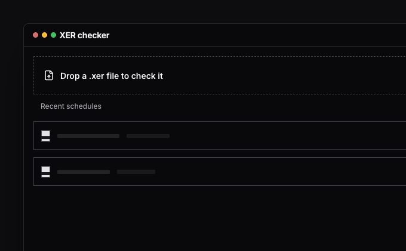
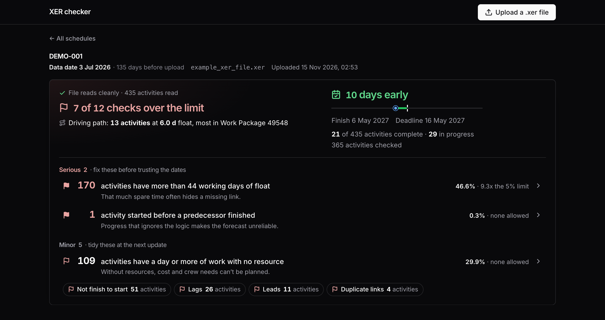
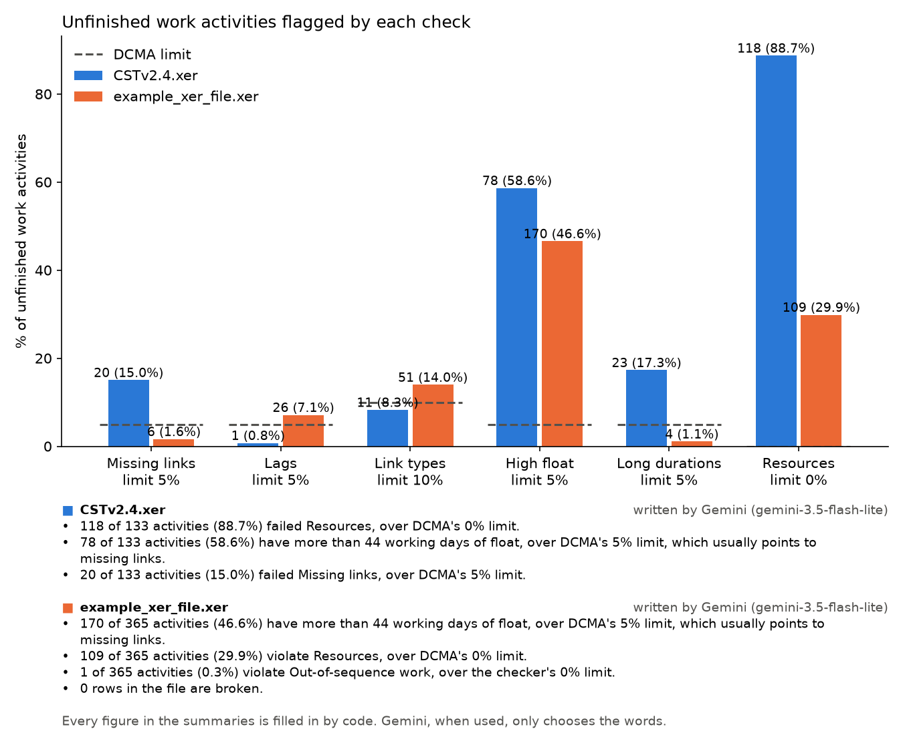

# XER checker

[](https://github.com/RiyasaatAhmed/xer-checker/actions/workflows/tests.yml)

**Upload a Primavera P6 schedule (`.xer`) and see what needs fixing first.** The app runs 21 health checks, shows where in the project the problems are, and lists the activities behind each one.

> [!NOTE]
> **The submitted version** is the [`take-home-submission`](https://github.com/RiyasaatAhmed/xer-checker/tree/take-home-submission) tag, from 9 Nov 2026: one script with the 3 checks and the chart. Everything on `main` since then is later work.

<p align="center">
  
</p>

## What it does

1. **Reads the file**, and flags broken rows with their line numbers.
2. **Runs 21 checks**, 14 of them DCMA's: logic, constraints, float, duration, dates and resources. [All 21 checks](docs/checks.md)
3. **Shows a report:** the verdict first, then the checks, where the problems are, and what to fix first. [Every feature](docs/features.md)
4. **Writes a short summary.** The AI picks the words; code fills in every number. [How](docs/ai-summary.md)
5. **Saves each upload**, so it can be opened again and shared by its link.



## Results on the 2 public files

| File | Activities checked | Broken rows | Missing links | Leads | Lags | Long lags | Negative float | High float |
|---|---|---|---|---|---|---|---|---|
| `CSTv2.4.xer` | 133 | 0 | 20 (15.0%) | 0 | 1 (0.8%) | 0 | 0 | 78 (58.6%) |
| `example_xer_file.xer` | 365 | 0 | 6 (1.6%) | 11 (3.0%) | 26 (7.1%) | 8 (2.2%) | 0 | 170 (46.6%) |

- **Matched to Kazinex:** these 6 checks give the same answers as Kazinex, an independent P6 checker, on every test run. [How it's tested](docs/validation.md)
- **What each number means:** [Results](docs/results.md).
- **Where the files come from:** [The 2 test files](docs/test-files.md).

The command line draws the same results as one chart:



- **Each bar:** the share of a file's unfinished activities a check caught. The dashed line is the DCMA limit.
- **Biggest problems:** no resources in `CSTv2.4.xer` (88.7%), and high float in both files (58.6% and 46.6%).

## Run it

```
docker compose up --build
```

| Open | What you get |
|---|---|
| http://localhost:3000 | The app: upload a file, see its report |
| http://localhost:8000/docs | The API, to try in the browser |

**Without Docker, from the command line, or in production with HTTPS:** [Running it](docs/running.md).

**Tests:** 277 backend and 114 frontend. They need no AI key, internet or database.

```
cd backend && pip install -r requirements-dev.txt && pytest
cd frontend && npm install && npm test
```

## More

| Doc | What it covers |
|---|---|
| [Features](docs/features.md) | Everything the app does, and what isn't done yet |
| [The checks](docs/checks.md) | All 21 checks, their limits, and where the rules come from |
| [Results](docs/results.md) | What the numbers on the 2 files mean |
| [Validation](docs/validation.md) | How every number is tested against Kazinex |
| [Running it](docs/running.md) | Without Docker, the command line, and broken files |
| [The API](docs/api.md) | The endpoints, their answers and status codes |
| [The AI summary](docs/ai-summary.md) | How the AI is kept from inventing a number, and how to set it up |
| [The code](docs/code.md) | The folders, and every file's job |
| [The 2 test files](docs/test-files.md) | Where the 2 public files come from |
| [Frontend](frontend/README.md) | The page, its look and its files |
| [Database](database/README.md) | The tables |
