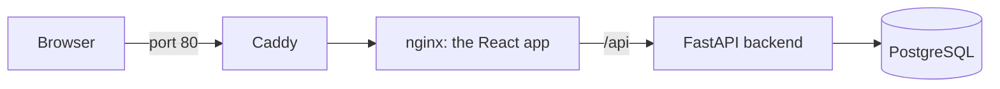

# Deployment: the app on AWS EC2

[Back to the README](../README.md)

**The app runs on one small AWS server at http://54.253.142.247.** The server runs the same Docker containers as a laptop does, through [`docker-compose.prod.yml`](../docker-compose.prod.yml). It costs about $15 a month, covered by AWS credits.

This is a demo deployment: it shows the whole app working on AWS. The [last section](#what-a-pilot-would-add) lists what a pilot for clients would add.

## Why one EC2 server

| Option | Why not, for now |
|---|---|
| **One EC2 server** ✅ | Runs the exact Docker setup used in development, so what's tested locally is what runs. Cheapest. Easy to inspect over SSH |
| ECS or Fargate | Containers managed by AWS. Worth it with several servers or teams; for one demo, it adds setup without adding value |
| App Runner, Lambda | The app needs PostgreSQL and long uploads, up to 500 MB. These fit poorly |
| Managed database (RDS) | About $15 a month more. A container database is enough for a demo |

The pilot plan named this setup for week 1: one EC2 server, Docker Compose, and Caddy for HTTPS.

## What runs

| Container | Job | Open to the internet |
|---|---|---|
| `caddy` | The front door. Serves HTTP now, and HTTPS once the app has a domain | Yes: ports 80 and 443 |
| `frontend` | nginx: serves the React app, passes `/api` to the backend | No |
| `backend` | FastAPI: checks the files, saves the results, calls Gemini for the summary | No |
| `database` | PostgreSQL 17: every upload and its results | No |

Only Caddy can be reached from outside. The backend and database talk to each other inside Docker's own network.

## The server's settings

| Setting | Value | Why |
|---|---|---|
| Region | Sydney (`ap-southeast-2`) | The account is on AWS's free plan, which allows one region. US East would be faster for New York; it needs a paid plan |
| Server type | `t3.micro`: 2 vCPU, 1 GB memory | Free-tier eligible, and enough for the app |
| Swap | 2 GB | Extra memory on disk, so builds don't run out of the 1 GB |
| CPU credits | Standard | A t3 server can burst. "Unlimited" bills extra for long bursts; "Standard" just slows down, so the bill never grows |
| Operating system | Amazon Linux 2023 | AWS's own Linux, supported until 2029 |
| Disk | 20 GB gp3 | Room for the Docker images and the database |
| Firewall | SSH from one office IP only; HTTP and HTTPS from anywhere | Only the developer can log in. Anyone can open the site |
| Address | The server's public IP | A demo needs no domain. The IP changes if the server is stopped and started; a reboot keeps it |

## Cost

| Item | About, per month |
|---|---|
| `t3.micro` server | $10 |
| 20 GB disk | $2 |
| Public IP address | $3.60 |
| **Total** | **$15** |

The account holds $100 of AWS credits for 182 days, about $16 a month. So the demo runs for the whole period at no charge.

## The steps taken

1. **Created a limited AWS user** for the command line, with EC2 rights only. The main login was not used for this.
2. **Launched the server** in the AWS console with the settings above. The free plan blocks command-line launches, so the console did this step.
3. **Installed Docker** and Docker Compose, and added 2 GB of swap.
4. **Copied the code** from GitHub, and the settings file (`.env`) from the developer's laptop. `.env` was never committed or printed.
5. **Gave the database a random password**, 48 characters, kept in `.env`.
6. **Built and started the containers** with `docker-compose.prod.yml`.
7. **Checked it end to end:** uploaded `CSTv2.4.xer` to the live site. It gave the locked numbers: 133 checked, 20 missing links, 0 negative float, 78 high float.

## Security

| What | How |
|---|---|
| Secrets | In `.env` on the server only, readable by its owner alone. Never in git |
| Logging in to the server | SSH key only, and only from one IP |
| Database | No port outside Docker. Its password is required, or it won't start |
| Restarts | Every container restarts by itself after a crash or a reboot |
| Logs | Capped at 5 files of 20 MB per container, so the disk can't fill |

**Known gaps, on purpose for a demo:**

- **No login.** Anyone with the address can upload or delete a file.
- **Plain HTTP.** Free HTTPS certificates need a domain name, not an IP. One side effect: browsers block the copy buttons on plain HTTP.

## Running it

| Task | Command, on the server |
|---|---|
| Log in | `ssh xer-checker`, from the developer's laptop |
| Redeploy after new commits | `cd ~/xer-checker && git pull && docker compose -f docker-compose.prod.yml up -d --build` |
| See what runs | `docker compose -f docker-compose.prod.yml ps` |
| Follow the logs | `docker compose -f docker-compose.prod.yml logs -f backend` |
| Stop everything | `docker compose -f docker-compose.prod.yml down`. The uploads stay |

[Running it](running.md#in-production) explains the production file in more detail.

## What a pilot would add

| Step | Why |
|---|---|
| A domain and HTTPS | A proper address, encrypted. Set `SITE_ADDRESS` to the domain; Caddy then gets the certificate itself |
| Login (Amazon Cognito) | Only invited users, and each sees their own files |
| A fixed IP (Elastic IP) | The address survives a stop and start. About $3.60 a month |
| US East region | Faster for New York. Needs the paid plan |
| Managed database and file storage (RDS, S3) | Automatic backups, and files kept apart from the server |
| Deploy on every push | GitHub Actions runs the tests, then redeploys |
