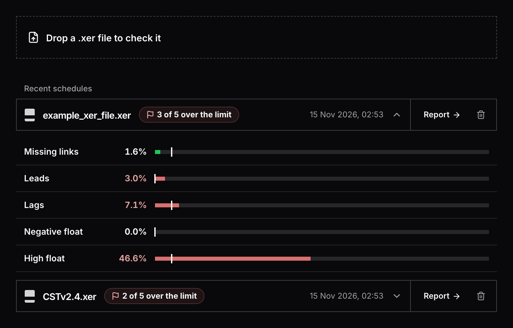
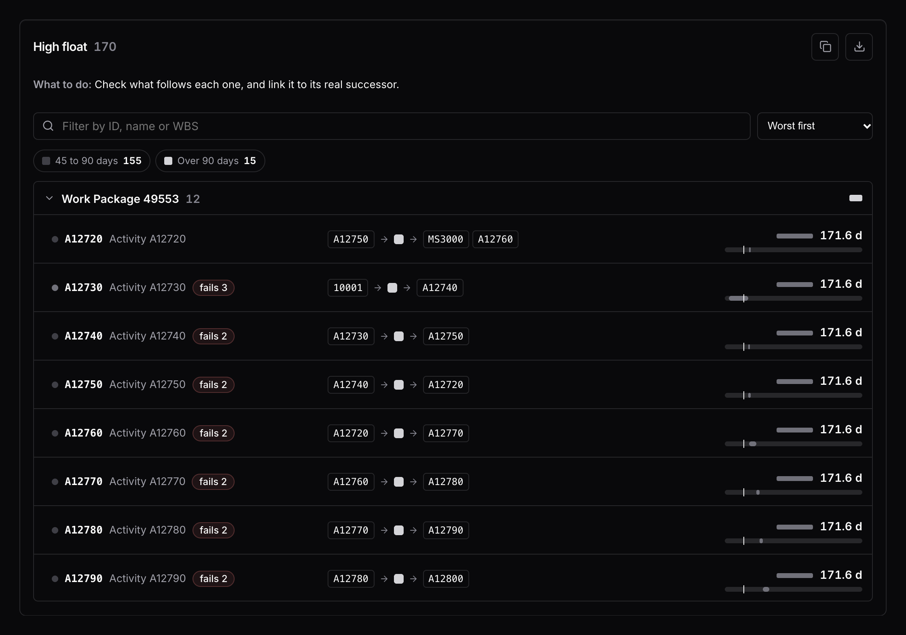

# Frontend

The page where you upload a `.xer` file and see where its problems are. Vite, React and TypeScript, in a calm, neutral tool design: little text, mostly pictures.


## What a scheduler gets

| Part | What it does |
|---|---|
| **Home** | The demo and one upload button before the first upload. After it, a drop area and the saved files. Each file is a row that opens on its 5 headline checks, with a one-click report and delete |
| **Upload** | Drop a `.xer` file anywhere on the page, or use the button. A wrong file type or a file over 50 MB is refused at once, before it's sent |
| **Verdict** | First on the page: whether the file reads cleanly, and how many checks are over the limit. Then the driving path, finish against deadline, and progress. Every check over the limit follows, as Serious or Minor |
| **The checks** | One cell per check in sets, then a bullet row for each failing check: its value, limit tick, how many times over, and the change. Passing checks and checks that can't run fold into a line each. Click one to list its activities |
| **Float** | One bar from late to spare time, coloured by how close to critical the work is |
| **Where** | The WBS tree as rows, worst first, counting the picked check, a set of checks or all flags. Cells show the months flagged work starts, with the span and finished share. The data date, forecast finish and deadline are labelled on the axis. A second view is a matrix of groups against sets of checks. Click a group to list its activities |
| **Fix first** | One open end behind many flags, and the activities that fail the most checks |
| **Activities** | Grouped by WBS group in one fixed-height window (520 px). It draws only the lines on screen, so 20 activities or 20,000 stay equally light. Each line shows its logic as `before → ■ → after`, with a red `none` on a missing side. Also its name, WBS, float as a bar and dates. Each group shows its worst 8 first, then "Show all". Group headers show a count and, when a check has several kinds, a bar of them. The kinds are filters. Sort worst first (the default), or by file order, float, most checks failed or ID. Filter by ID, name or WBS, copy the IDs, or download every column as CSV |
| **File profile** | One small card: five counts (activities, links, leads, lags, constraints) and two bars (status, and what the checks leave out) |
| **Summary and broken rows** | The summary is folded away. Broken rows show only when the file has some |

| **Recent schedules** | Every saved schedule, newest first. Each has its own address (`/uploads/<id>`). So does each check in it (`/uploads/<id>/checks/<check>`). Refresh, Back and a shared link all work |

**The home page is simple.** With no checks yet it shows a short looping demo, built with [Stageshow](https://github.com/benjitaylor/skills/tree/main/stageshow), and one upload button. Once there are checks it shows the drop area and the saved files. A schedule has an "All schedules" link back.







## Run it

```
npm install
npm run dev       # http://localhost:5173
```

The page sends `/api` calls to the backend at http://localhost:8000. Start it first, from `backend/`, with `uvicorn main:app --reload`. To use another address, set `API_URL`.

| Command | What it does |
|---|---|
| `npm test` | Runs the tests. The backend is faked, so it doesn't need to run |
| `npm run lint` | Checks the code with oxlint (the copied `src/kit/` is skipped) |
| `npm run build` | Builds the app into `dist/` |

## The look

All colors, type and shapes are tokens in [`src/theme.css`](src/theme.css). The design is neutral and quiet, so the data stands out.

| Token | Value | Used for |
|---|---|---|
| `--bg`, `--surface`, `--sunken` | `#f4f5f7`, `#ffffff`, `#edf0f3` | The page, cards, tracks |
| `--ink`, `--muted` | `#151a22`, `#5c6675` | Text |
| `--accent` | `#3b5bdb` | Actions, links, the selected check |
| `--flag` | `#d92d20` | Flagged by a DCMA check. Nothing else is red |
| `--ok` | `#12a150` | Within the limit |
| `--slate` | `#7d8da3` | Neutral bars and work periods |
| Tooltips | One shared bubble | Any element with `data-tip` gets it on hover or keyboard focus. Escape closes it, and the pointer can rest on it |
| Fonts | Inter, and the system's monospace font | Inter is bundled with the app, so no call to a font service |

**Rules:** one accent, red only for flagged, 8px corners, no uppercase labels. A status always shows an icon and a word, never color alone. Dark mode has its own tokens.

## Files

| File | Its one job |
|---|---|
| `src/App.tsx` | The page: the address bar, uploads, loading and errors, the drop target |
| `src/api.ts` | Uploads a file, lists saved schedules, opens one, loads one check's activities; turns errors into plain messages |
| `src/route.ts` | Reads and writes `/uploads/<id>` and `/uploads/<id>/checks/<check>` in the address bar |
| `src/board.ts` | The logic behind the check board: ranking, ratio to the limit, change since last time, what the map counts (tested on its own) |
| `src/validate.ts` | Refuses a wrong file type or size before upload |
| `src/rules.ts` | What each check means, and what to do in P6, by the check's ID |
| `src/format.ts` | Percents, counts, dates and CSV |
| `src/components/Verdict.tsx`, `FinishGap.tsx` | The first answer: checks over, the worst, finish against deadline |
| `src/components/CheckBoard.tsx`, `HealthStrip.tsx`, `CheckRow.tsx` | All the checks: the strip, the failing rows, the folds |
| `src/components/FloatStrip.tsx` | Float as one bar |
| `src/components/WbsMatrix.tsx`, `FixFirst.tsx`, `MiniStrip.tsx` | The matrix, the fix-first panel, and the small strip on the list |
| `src/components/FlaggedActivities.tsx` | Loads one check's activities, then the kinds, sort, filters, copy and CSV |
| `src/components/ActivityGroups.tsx` | The groups and their lines, as one flat list for the scroll window |
| `src/components/VirtualList.tsx`, `src/virtual.ts` | The fixed-height scroll window, and the maths of which lines are on screen (tested on its own) |
| `src/components/LogicChain.tsx` | One activity's logic on one line: before, it, after |
| `src/categories.ts` | The kinds a check's activities fall into, from what the backend names |
| `src/components/ScheduleMap.tsx` | The WBS tree as rows: flagged of checked, month heat, progress and the key dates |
| `src/components/LogicDiagram.tsx` | One activity with what comes before and after it |
| `src/timeline.ts`, `src/tree.ts` | The date axis, and the WBS tree helpers (tested on their own) |
| `src/components/FileProfile.tsx` | What's in the file: five counts and two bars |
| `src/components/HeroDemo.tsx` | The Stageshow demo on the empty screen. Its film notes are in `REHEARSAL.md` |
| `src/components/*.tsx` | One component per file: the summary, file issues, recent schedules and the rest |
| `src/kit/` | Stageshow's React kit (MIT), copied in. Its README says what changed |
| `nginx.conf` | In Docker: serves the app, sends every page path to it, and passes `/api` to the backend |

## Changing the demo

The demo follows the [Stageshow](https://github.com/benjitaylor/skills) skill's rules and is checked with its film gate. To change it, restore the skill first. It's listed in `skills-lock.json` at the repo root, and its files are gitignored:

```
npx skills experimental_install
```

Then film it from the skill's folder, at both widths, until each film ends `rehearsal passed`:

```
cd .claude/skills/stageshow && npm install
node scripts/film.mjs http://localhost:5173/ --out shots/demo.png --every 800 --count 18 --gate
node scripts/film.mjs http://localhost:5173/ --out shots/phone.png --width 390 --every 1600 --count 9 --gate
```
