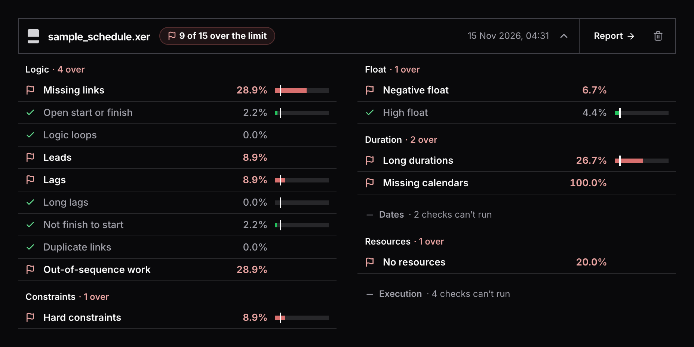

# Frontend

The page where you upload a `.xer` file and see where its problems are. Vite, React and TypeScript, in a calm, neutral tool design: little text, mostly pictures.


## What a scheduler gets

| Part | What it does |
|---|---|
| **Home** | The demo and one upload button before the first upload. After it, a drop area and the saved files. Each file is a row that opens on every check, by set, with a one-click report and delete. Its bars use the report's scale: the share of activities checked, 0 to 100% |
| **Recent schedules** | Every saved schedule, newest first. Each has its own report address (`/report/<id>`). So does each check in it (`/report/<id>/checks/<check>`). An older `/uploads/<id>` link still opens. Refresh, Back and a shared link all work |
| **Upload** | Drop a `.xer` file anywhere on the page, or use the button. A wrong file type or a file over 500 MB is refused at once, before it's sent |
| **Verdict** | First on the page: whether the file reads cleanly, and how many checks are over the limit. How many of those are serious and how many minor. Then the driving path, finish against deadline, and progress. The checks themselves are on the board below, listed once |
| **The checks** | One card headed "Checks". First, a bar per set of checks: the activities failing at least one check in the set, each counted once. Click a set to show only its checks. Then a bullet row for each failing check, under Serious or Minor. A row shows its value, limit tick, how many times over, and the change. Every bar sits on one axis, 0 to 100% of the activities checked, so lengths compare down the board. A check with a limit of 0 gets a bar too. Passing checks and checks that can't run fold into a line each. Click one to list its activities |
| **Float** | One bar from late to spare time, coloured by how close to critical the work is |
| **Where** | The WBS tree as rows, worst first, counting the picked check, a set of checks or all flags. A small bar per month shows how many flagged activities start then: taller is more. A thin bar under it shows the span and finished share. The data date, forecast finish and deadline are labelled on the axis. A second view is a matrix of groups against sets of checks. Click a group to list its activities |
| **Fix first** | One open end behind many flags. Then the activities that fail the most checks, as a grid: checks down, activities across, a mark where one fails |
| **Activities** | Grouped by WBS group in one fixed-height window (520 px). It draws only the lines on screen, so 20 activities or 20,000 stay equally light. Each line shows its logic as `before → ■ → after`, with a red `none` on a missing side. Also its name, WBS, float as a bar and dates. Each group shows its worst 8 first, then "Show all". Group headers show a count and, when a check has several kinds, a bar of them. The kinds are filters. Sort worst first (the default), or by file order, float, most checks failed or ID. Filter by ID, name or WBS, copy the IDs, or download every column as CSV |
| **File profile** | One small card: five counts (activities, links, leads, lags, constraints) and two bars (status, and what the checks leave out) |
| **Summary and broken rows** | A one-line verdict with a copy button, to paste into an email. The written points show under it, open; a click folds them away. Broken rows show only when the file has some |

**The home page is simple.** With no checks yet it shows a short looping demo, built with [Stageshow](https://github.com/benjitaylor/skills/tree/main/stageshow), and one upload button. Once there are checks it shows the drop area and the saved files. A schedule has an "All schedules" link back.




## Run it

```
npm install
npm run dev       # http://localhost:5173
```

The page sends `/api` calls to the backend at http://localhost:8000. Start it first, from `backend/`, with `uvicorn main:app --reload`. To use another address, set `API_URL`.

| Command | What it does |
|---|---|
| `npm test` | Runs the tests. The backend is faked, so it doesn't need to run |
| `npm run lint` | Checks the code with oxlint (the copied `src/kit/` is skipped) |
| `npm run build` | Builds the app into `dist/` |

## The look

All colors, type and shapes are tokens in [`src/theme.css`](src/theme.css). The design is neutral and quiet, so the data stands out. It's dark by default, in black and zinc. The light set applies under `data-theme="light"`.

| Token | Dark (default) | Light | Used for |
|---|---|---|---|
| `--bg`, `--surface`, `--sunken` | `#09090b`, `#09090b`, `#27272a` | `#ffffff`, `#ffffff`, `#f4f4f5` | The page, cards, tracks |
| `--ink`, `--muted` | `#fafafa`, `#a1a1aa` | `#09090b`, `#71717a` | Text |
| `--accent` | `#fafafa` | `#18181b` | Actions, links, the selected check |
| `--flag` | `#d9706f` | `#d65d5d` | Flagged by a check. Nothing else is red |
| `--ok` | `#24c25e` | `#1a9948` | Within the limit |
| `--slate` | `#71717a` | `#71717a` | Neutral bars and work periods |
| Tooltips | One shared bubble | Same | Any element with `data-tip` gets it on hover or keyboard focus. Escape closes it, and the pointer can rest on it |
| Fonts | Inter, and the system's monospace font | Same | Inter is bundled with the app, so no call to a font service |

**Rules:** one near-white accent, red only for flagged, 8px corners, no uppercase labels. A status always shows an icon and a word, never color alone.

## Files

| File | Its one job |
|---|---|
| `src/App.tsx` | The page: the address bar, uploads, loading and errors, the drop target |
| `src/api.ts` | Uploads a file, lists saved schedules, opens one, loads one check's activities; turns errors into plain messages |
| `src/route.ts` | Reads and writes `/report/<id>` and `/report/<id>/checks/<check>` in the address bar, and moves an older `/uploads/` link to it |
| `src/board.ts` | The logic behind the check board: ranking, ratio to the limit, change since last time, what the map counts (tested on its own) |
| `src/validate.ts` | Refuses a wrong file type or size before upload |
| `src/rules.ts` | What each check means, and what to do in P6, by the check's ID |
| `src/format.ts` | Percents, counts, dates and CSV |
| `src/components/Home.tsx`, `DropArea.tsx`, `LiveCheck.tsx`, `RecentUploads.tsx` | The home page: the drop area, the file being checked, and the saved files |
| `src/components/CheckBars.tsx`, `ChecksBadge.tsx` | A file's checks by set on the home page, and its "4 of 17 over the limit" badge |
| `src/components/Verdict.tsx`, `FinishGap.tsx` | The first answer: trust, checks over and how serious, the driving path, finish against deadline, progress |
| `src/components/CheckBoard.tsx`, `SetBars.tsx`, `CheckRow.tsx` | All the checks: the axis, the bars per set, the failing rows, the folds |
| `src/components/FloatStrip.tsx` | Float as one bar |
| `src/components/WbsMatrix.tsx`, `FixFirst.tsx` | The matrix of WBS groups against sets of checks, and the fix-first panel with its grid |
| `src/components/FlaggedActivities.tsx` | Loads one check's activities, then the kinds, sort, filters, copy and CSV |
| `src/components/ActivityGroups.tsx` | The groups and their lines, as one flat list for the scroll window |
| `src/components/VirtualList.tsx`, `src/virtual.ts` | The fixed-height scroll window, and the maths of which lines are on screen (tested on its own) |
| `src/components/LogicChain.tsx` | One activity's logic on one line: before, it, after |
| `src/categories.ts` | The kinds a check's activities fall into, from what the backend names |
| `src/components/ScheduleMap.tsx` | The WBS tree as rows: flagged of checked, a bar per month, progress and the key dates |
| `src/timeline.ts`, `src/tree.ts` | The date axis, and the WBS tree helpers (tested on their own) |
| `src/components/FileProfile.tsx` | What's in the file: five counts and two bars |
| `src/components/HeroDemo.tsx` | The Stageshow demo on the empty screen. Its film notes are in `REHEARSAL.md` |
| `src/components/*.tsx` | One component per file: the summary, file issues and the rest |
| `src/kit/` | Stageshow's React kit (MIT), copied in. Its README says what changed |
| `nginx.conf` | In Docker: serves the app, sends every page path to it, and passes `/api` to the backend |

## Changing the demo

The demo follows the [Stageshow](https://github.com/benjitaylor/skills) skill's rules and is checked with its film gate. To change it, restore the skill first. It's listed in `skills-lock.json` at the repo root, and its files are gitignored:

```
npx skills experimental_install
```

The demo shows only while the saved list is empty. So run `npm run dev` with `API_URL` pointing at an API that answers `[]` to `GET /api/uploads`. `REHEARSAL.md` says how.

Then film it from the skill's folder, at both widths, until each film ends `rehearsal passed`:

```
cd .claude/skills/stageshow && npm install
node scripts/film.mjs http://localhost:5173/ --out shots/demo.png --every 800 --count 18 --gate
node scripts/film.mjs http://localhost:5173/ --out shots/phone.png --width 390 --every 1600 --count 9 --gate
```
