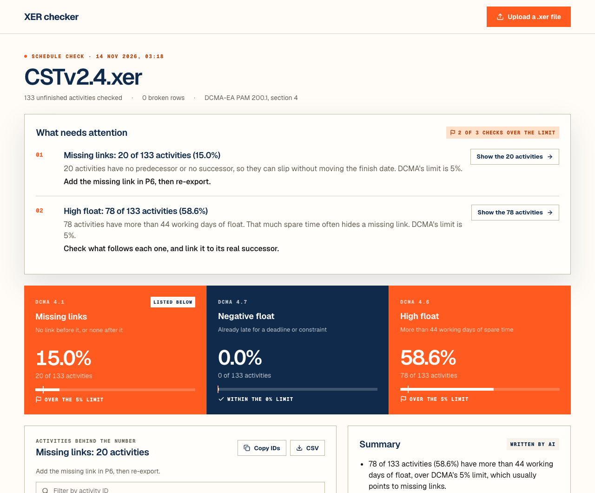

# Frontend

The page where you upload a `.xer` file and see what needs attention. Vite, React and TypeScript, styled after [thecritpath.com](https://thecritpath.com/).



## What a scheduler gets

| Part | What it does |
|---|---|
| **Upload** | Drop a `.xer` file anywhere on the page, or use the button. A wrong file type or a file over 50 MB is refused at once, before it's sent |
| **What needs attention** | First on the page: one numbered item per check over its limit, with what it means and the next step in P6 |
| **The 3 checks** | A navy band, one column each, with the DCMA section, the figure and the limit. A check over its limit turns orange |
| **Activities behind the number** | Filter the activity IDs, copy them all (one per line, ready for P6 or Excel), or download a CSV |
| **Summary and the file** | The written summary and who wrote it; broken rows with their line numbers |
| **Recent checks** | Every saved check, newest first. Each has its own address (`/uploads/<id>`), so refresh, Back and a shared link all work |

The empty screen shows a short looping demo of a check, built with [Stageshow](https://github.com/benjitaylor/skills/tree/main/stageshow).


## Run it

```
npm install
npm run dev       # http://localhost:5173
```

The page sends `/api` calls to the backend at http://localhost:8000. Start it first, from `backend/`, with `uvicorn main:app --reload`. To use another address, set `API_URL`.

| Command | What it does |
|---|---|
| `npm test` | Runs the tests. The backend is faked, so it doesn't need to run |
| `npm run lint` | Checks the code with oxlint (the copied `src/kit/` is skipped) |
| `npm run build` | Builds the app into `dist/` |

## The look

All colors, type and shapes are tokens in [`src/theme.css`](src/theme.css), taken from thecritpath.com's own CSS:

| Token | Value | Used for |
|---|---|---|
| `--cream`, `--paper`, `--card` | `#fffcf7`, `#f7f3ea`, `#fffefa` | The page, quiet bands, cards |
| `--navy` | `#0f2a4a` | Headings and the checks band |
| `--orange` | `#ff5a1f` | The one accent: actions, and checks over their limit |
| `--green` | `#2f8f62` | Within the limit |
| Fonts | Geist, Geist Mono | Bundled with the app, so no call to a font service |

**Rules:** square corners, mono capitals for small labels, and a status always shows an icon and a word, never color alone. Dark mode has its own tokens.

## Files

| File | Its one job |
|---|---|
| `src/App.tsx` | The page: the address bar, uploads, loading and errors, the drop target |
| `src/api.ts` | Uploads a file, lists saved checks, opens one; turns errors into plain messages |
| `src/route.ts` | Reads and writes `/uploads/<id>` in the address bar |
| `src/validate.ts` | Refuses a wrong file type or size before upload |
| `src/rules.ts` | What each check means, and what to do in P6 |
| `src/format.ts` | Percents, counts, dates and CSV |
| `src/components/ActionBrief.tsx` | What needs attention, numbered |
| `src/components/RuleBand.tsx` | The 3 checks on the navy band |
| `src/components/FlaggedActivities.tsx` | The activity IDs behind a check: filter, copy, CSV |
| `src/components/HeroDemo.tsx` | The Stageshow demo on the empty screen. Its film notes are in `REHEARSAL.md` |
| `src/components/*.tsx` | One component per file: the summary, file issues, recent checks and the rest |
| `src/kit/` | Stageshow's React kit (MIT), copied in. Its README says what changed |
| `nginx.conf` | In Docker: serves the app, sends every page path to it, and passes `/api` to the backend |

## Changing the demo

The demo follows the [Stageshow](https://github.com/benjitaylor/skills) skill's rules and is checked with its film gate. To change it, restore the skill first. It's listed in `skills-lock.json` at the repo root, and its files are gitignored:

```
npx skills experimental_install
```

Then film it from the skill's folder, at both widths, until each film ends `rehearsal passed`:

```
cd .claude/skills/stageshow && npm install
node scripts/film.mjs http://localhost:5173/ --out shots/demo.png --every 800 --count 18 --gate
node scripts/film.mjs http://localhost:5173/ --out shots/phone.png --width 390 --every 1600 --count 9 --gate
```
