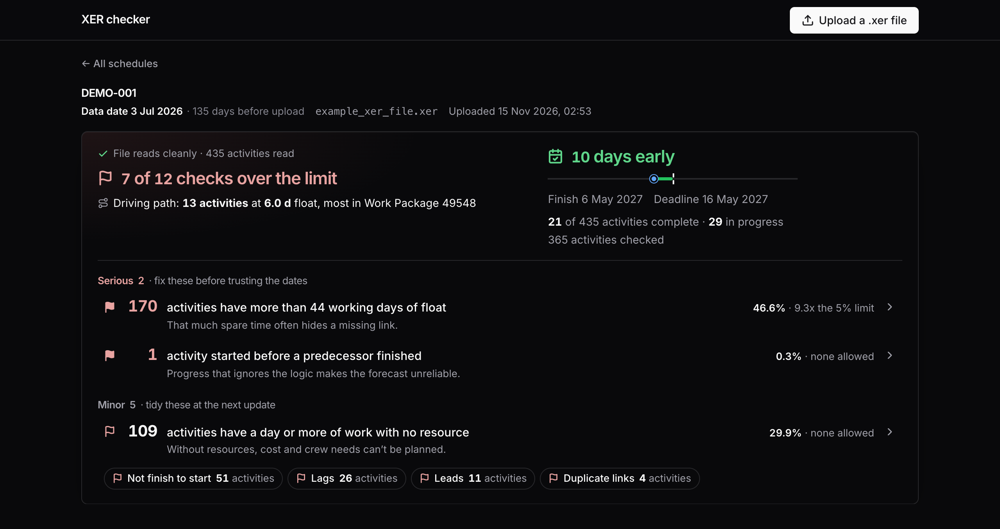
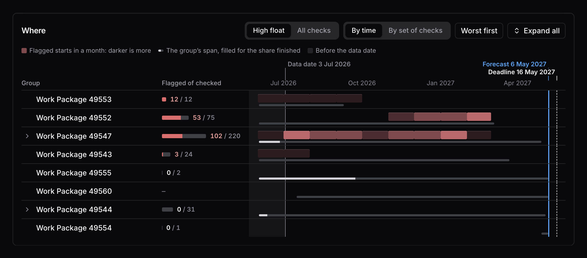
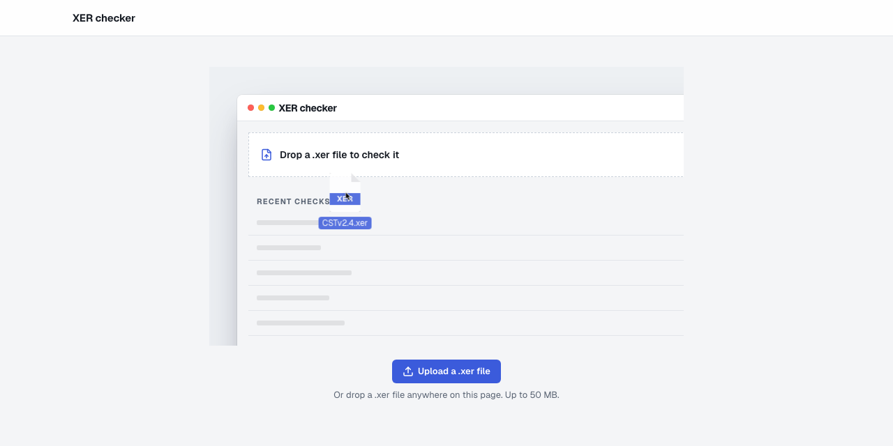

# Frontend

The page where you upload a `.xer` file and see where its problems are. Vite, React and TypeScript, in a calm, neutral tool design: little text, mostly pictures.



## What a scheduler gets

| Part | What it does |
|---|---|
| **Home** | The demo and one upload button, or the list of recent checks. Nothing else |
| **Upload** | Drop a `.xer` file anywhere on the page, or use the button. A wrong file type or a file over 50 MB is refused at once, before it's sent |
| **The 3 checks** | First on the page. Each is a value against its DCMA limit, on one 0 to 100% scale so they compare, with an icon for over or within. Click one to list its activities |
| **Schedule map** | The WBS tree as rows: red for flagged activities, grey for fine, and a bar for when its work happens. The data date, forecast finish and deadline are labelled on the axis, with a chip for how far the forecast is from the deadline. Open a group, or click it to list its activities |
| **Activities** | Each flagged activity's ID, name, WBS, links before and after (a 0 is the missing link), float as a small bar, and dates. Sort, filter, copy the IDs, or download every column as CSV. Click the links for the logic diagram: before, this activity, after |
| **File profile** | One small card: five counts (activities, links, leads, lags, constraints) and two bars (status, float). A float band over its limit links to its activities |
| **Summary and broken rows** | The summary is folded away. Broken rows show only when the file has some |

| **Recent checks** | Every saved check, newest first. Each has its own address (`/uploads/<id>`), so refresh, Back and a shared link all work |

**The home page is simple.** With no checks yet it shows a short looping demo, built with [Stageshow](https://github.com/benjitaylor/skills/tree/main/stageshow), and one upload button. Once there are checks it shows the list and the button. A check has an "All checks" link back.





## Run it

```
npm install
npm run dev       # http://localhost:5173
```

The page sends `/api` calls to the backend at http://localhost:8000. Start it first, from `backend/`, with `uvicorn main:app --reload`. To use another address, set `API_URL`.

| Command | What it does |
|---|---|
| `npm test` | Runs the tests. The backend is faked, so it doesn't need to run |
| `npm run lint` | Checks the code with oxlint (the copied `src/kit/` is skipped) |
| `npm run build` | Builds the app into `dist/` |

## The look

All colors, type and shapes are tokens in [`src/theme.css`](src/theme.css). The design is neutral and quiet, so the data stands out.

| Token | Value | Used for |
|---|---|---|
| `--bg`, `--surface`, `--sunken` | `#f4f5f7`, `#ffffff`, `#edf0f3` | The page, cards, tracks |
| `--ink`, `--muted` | `#151a22`, `#5c6675` | Text |
| `--accent` | `#3b5bdb` | Actions, links, the selected check |
| `--flag` | `#d92d20` | Flagged by a DCMA check. Nothing else is red |
| `--ok` | `#12a150` | Within the limit |
| `--slate` | `#7d8da3` | Neutral bars and work periods |
| Fonts | Geist, Geist Mono | Bundled with the app, so no call to a font service |

**Rules:** one accent, red only for flagged, 8px corners, no uppercase labels. A status always shows an icon and a word, never color alone. Dark mode has its own tokens.

## Files

| File | Its one job |
|---|---|
| `src/App.tsx` | The page: the address bar, uploads, loading and errors, the drop target |
| `src/api.ts` | Uploads a file, lists saved checks, opens one; turns errors into plain messages |
| `src/route.ts` | Reads and writes `/uploads/<id>` in the address bar |
| `src/validate.ts` | Refuses a wrong file type or size before upload |
| `src/rules.ts` | What each check means, and what to do in P6 |
| `src/format.ts` | Percents, counts, dates and CSV |
| `src/components/Health.tsx` | The 3 checks: a value against its limit |
| `src/components/FlaggedActivities.tsx` | The activities behind a check: sort, filter, copy, CSV. On phones: ID, name, links and float |
| `src/components/ScheduleMap.tsx` | The WBS tree as rows: flagged of checked, and a timeline with the key dates labelled |
| `src/components/LogicDiagram.tsx` | One activity with what comes before and after it |
| `src/timeline.ts`, `src/tree.ts` | The date axis, and the WBS tree helpers (tested on their own) |
| `src/components/FileProfile.tsx` | What's in the file: five counts and two bars |
| `src/components/HeroDemo.tsx` | The Stageshow demo on the empty screen. Its film notes are in `REHEARSAL.md` |
| `src/components/*.tsx` | One component per file: the summary, file issues, recent checks and the rest |
| `src/kit/` | Stageshow's React kit (MIT), copied in. Its README says what changed |
| `nginx.conf` | In Docker: serves the app, sends every page path to it, and passes `/api` to the backend |

## Changing the demo

The demo follows the [Stageshow](https://github.com/benjitaylor/skills) skill's rules and is checked with its film gate. To change it, restore the skill first. It's listed in `skills-lock.json` at the repo root, and its files are gitignored:

```
npx skills experimental_install
```

Then film it from the skill's folder, at both widths, until each film ends `rehearsal passed`:

```
cd .claude/skills/stageshow && npm install
node scripts/film.mjs http://localhost:5173/ --out shots/demo.png --every 800 --count 18 --gate
node scripts/film.mjs http://localhost:5173/ --out shots/phone.png --width 390 --every 1600 --count 9 --gate
```
